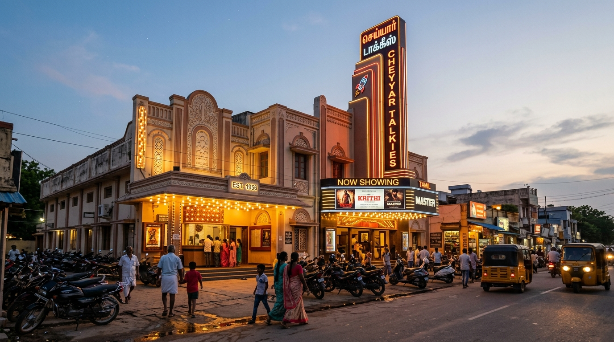

# 🏙️ Cheyyar 3D Virtual Town & Cheyyar Talkies (செய்யாறு 3D)

A full-fledged 3D virtual town and interactive cinema experience dedicated entirely to **Cheyyar Town (செய்யாறு)**, Tamil Nadu.



---

## 🌟 Key Features

### 1. 🏛️ Cheyyar Town Landmarks
Experience 9 iconic Cheyyar landmarks modeled and textured:
- **Sri Vedapureeswarar Temple (ஸ்ரீ வேதபுரீஸ்வரர் திருக்கோயில்)** — Town Centre & default spawn
- **Cheyyar Talkies (செய்யாறு டாக்கீஸ்)** — Single dedicated cinema screening *Leo*
- **Cheyyar Central Bus Stand (செய்யாறு பேருந்து நிலையம்)**
- **Cheyyar River & Historic Bridge (செய்யாறு நதி & பாலம்)**
- **Cheyyar Clock Tower & Bazaar Roundabout (செய்யாறு மணிக்கூண்டு)**
- **Cheyyar SIPCOT Industrial Park (சிப்காட் தொழிற்பேட்டை)**
- **Cheyyar Cooperative Sugar Mills (கூட்டுறவு சர்க்கரை ஆலை)**
- **Arignar Anna Govt Arts College (அறிஞர் அண்ணா கலைக்கல்லூரி)**
- **Cheyyar Government Taluk Hospital (அரசு தலைமை மருத்துவமனை)**

---

### 2. 🎬 Cheyyar Talkies & *Leo* Screening
- **Single Cinema Hall**: Exclusively named **Cheyyar Talkies (செய்யாறு டாக்கீஸ்)**.
- **Daily 4 Shows**:
  - `10:00 AM` (Morning Show)
  - `2:00 PM` (Matinee Show)
  - `6:30 PM` (First Show)
  - `9:00 PM` (Second Show)
- **Advance Ticket Booking (முன்பதிவு)**:
  - Users can book their preferred seats anytime 24/7 prior to the show!
  - Clicking the cinema door opens options to **🎟 Book Seat in Advance** or **🏛 Enter Cinema Lobby**.
- **Real-Time Synchronized Playback**:
  - Embedded YouTube player for *Leo* (`-VPw6akXfiM`).
  - If a user enters 30 minutes after showtime, the movie starts automatically at the 30-minute mark (`pos: 1800s`), not from the beginning.
- **Persistent Reserved Seating**:
  - Seat allocations remain locked to your player session even if you exit and re-enter.

---

### 3. 👥 Live Multiplayer Synchronization
- Real-time peer tracking across all connected desktop and mobile users via `/api/index.php?a=live`.
- Players see other characters walking, running, jumping, and emoting with 3D nametags.
- Active Cheyyar citizens (Vignesh, Kavitha, Dinesh, Praveen, Anand) populate the town.

---

### 4. 📱 Mobile Touch Controls & Virtual Joystick
- **Smart Touch Detection**: Automatically activates on mobile devices, smartphones, and tablets (`pointer: coarse`, `ontouchstart`, or screens $\le 1024\text{px}$).
- **Virtual Joystick**: Smooth 360-degree analog stick on bottom-left for walking and running.
- **Action Buttons**: Floating jump, interact (`E`), and sprint buttons on bottom-right.
- **1-Click HUD Toggle**: Direct `🎮` button in the upper toolbar to toggle touch controls on/off on any device.

---

### 5. 🔐 Clean Authentication & Firebase Ready
- Modern login screen with:
  - `Sign in with Google`
  - `Play as Guest` (with avatar customization: Male / Female)
- Ready for Firebase Authentication integration.

---

## 🚀 Getting Started

### Prerequisites
- [Node.js](https://nodejs.org/) (v16 or higher)

### Run Locally
```bash
# Clone or navigate to the directory
cd nestmedia-clone

# Start the game server
npm start
# or
node server.js
```
Open your browser and navigate to:
```
http://localhost:3000/
```

---

## 📤 Pushing to Your GitHub Repository

Follow these simple steps in your terminal (PowerShell or Git Bash) to push this project to your GitHub:

```bash
# 1. Stage all project files
git add .

# 2. Create the initial commit
git commit -m "Cheyyar 3D Town & Cheyyar Talkies with Leo Screening, Multiplayer, and Mobile Touch Controls"

# 3. Rename branch to main
git branch -M main

# 4. Link your remote GitHub repository (replace with your repo URL)
git remote add origin https://github.com/YOUR_GITHUB_USERNAME/YOUR_REPOSITORY_NAME.git

# 5. Push to GitHub
git push -u origin main
```

---

## 📁 Project Architecture

- `server.js` — High-performance Node.js backend handling API routing, multiplayer live polling, cinema show synchronization, seat booking, and static file serving.
- `public/` — Static web client:
  - `index.html` — Entry point with mobile touch hooks and modern UI overlays.
  - `assets/index-B6ZfsRmH.js` — Core 3D engine (Three.js bundle with Cheyyar world, touch controller, advance booking modal).
  - `assets/lobby-DU5i-580.js` — Cheyyar Talkies cinema lobby & seat map module with advance ticket booking enabled.
  - `assets/modern-cheyyar.css` — Modern glassmorphism UI styles for touch joystick, HUD, and cinema modals.
  - `images/landmarks/` — Authentic photography for all Cheyyar landmarks and cinema posters.
- `build_clean_bundle.cjs` — Bundle generator for customizing territories, landmarks, and touch configurations.

---

## 📜 License
MIT License. Created for the people of Cheyyar Town (செய்யாறு).
